# Forge Neo Image Tagger

Forge Neo の **Image Tagger** タブで、WD・PixAI によるタグ抽出と、LM Studio による画像解析・文章からのプロンプト補完を使えます。

## 導入

このフォルダーを Forge Neo の `extensions` に配置し、Forge Neo を起動します。すでに起動中なら、生成が終わってから通常の方法で再起動します。**Image Tagger** タブが追加されます。対象は Forge Neo の Gradio 4 系です。

Git を使う場合は、Forge Neo のルートフォルダーで次を実行します。

```shell
git clone https://github.com/ukr8b3g-cmyk/Forge-Neo-Image-Tagger.git extensions/Forge-Neo-Image-Tagger
```

ZIP で導入する場合は [Releases](https://github.com/ukr8b3g-cmyk/Forge-Neo-Image-Tagger/releases) の **Source code (zip)** を展開し、`scripts` と `ui` が直下にあるフォルダーを `extensions` に置きます。すでに手動導入している場合は、同じ拡張を二重に配置しないようにしてください。

Forge の Python 環境に Pillow、NumPy と、互換性のある ONNX Runtime が必要です。**CPU** は `onnxruntime`、**CUDA** は環境に合う `onnxruntime-gpu` を使用します。利用中の Forge の CUDA・cuDNN と対応する版を選んでください。 [ONNX Runtime の CUDA 対応表](https://onnxruntime.ai/docs/execution-providers/CUDA-ExecutionProvider.html#requirements)

## 画面で見る使い方

### WD・PixAI でタグを作る

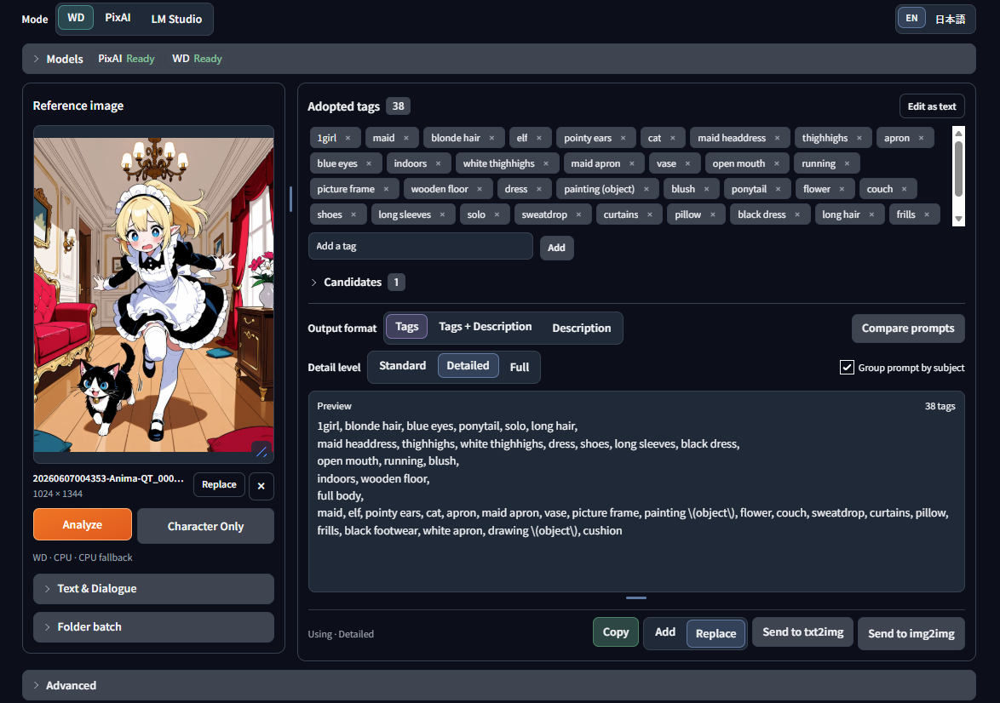

左上で **WD** または **PixAI** を選び、左に画像を入れて **Analyze** を押します。人物の外見や服装に絞るときは **Character Only** を使います。右の **Adopted tags** から不要なタグを外し、足りないものは **Add a tag** で追加します。操作名は右上の **日本語** で切り替えられます。

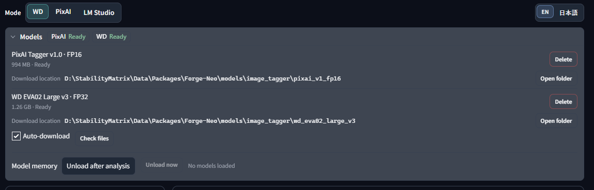

上部の **Models** を開くと、各モデルの取得状態と実際の保存先が分かります。**Auto-download** で必要なモデルを取得し、**Open folder** で保存先を開けます。**Unload now** はメモリを解放し、各モデルの **Delete** は確認後にダウンロード済みファイルを削除します。

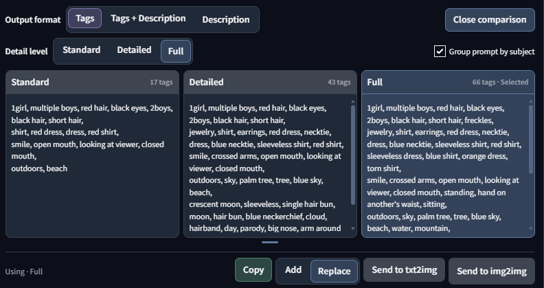

**Compare prompts** を押すと、1回の解析結果を **Standard / Detailed / Full** の3列で比較できます。見出しをクリックしてコピー・送信する列を選びます。**Output format** ではタグ・タグ＋説明文・説明文を切り替え、**Group prompt by subject** では項目ごとに改行できます。

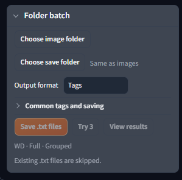

複数枚をまとめて処理するには、参照画像の下の **Folder batch → Choose image folder** でフォルダーを選びます。**Save .txt files** を押すと画像と同じ場所に同名のテキストを保存します。別の場所にまとめる場合は **Choose save folder** を指定します。既存の同名テキストはスキップされます。

### LM Studio で説明文を作る

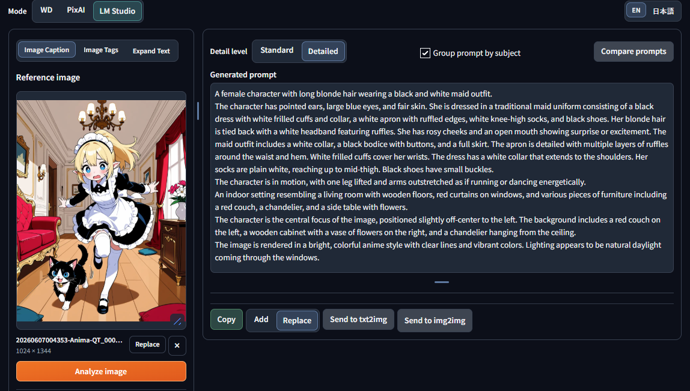

上部で **LM Studio** を選びます。**Image Caption** は画像から説明文、**Image Tags** は画像からタグ、**Expand Text** は入力した短文からプロンプトを作ります。画像を使うときは左の **Analyze image** を押し、右の **Generated prompt** で結果を確認・編集します。

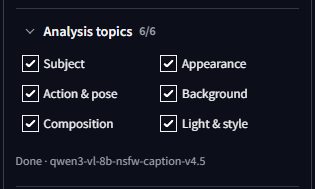

解析ボタンの下の **Analysis topics** で、被写体、外見・服装、動作・ポーズ、背景、構図、光・画風を選べます。初期状態では全項目がオンです。服装や髪型に集中したいときは **Appearance** だけを選んで解析します。

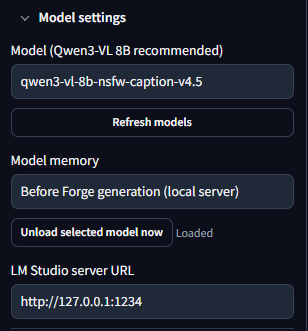

左側の **Model settings** で LM Studio のサーバーURLを確認し、**Refresh models** から使うモデルを選びます。画像解析には画像対応モデルが必要です。推奨は **Qwen3-VL 8B** です。**Model memory** で解放のタイミングを選び、**Unload selected model now** で今すぐ解放できます。

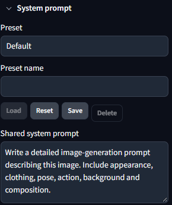

説明の書き方を変えたいときは **System prompt** を開きます。**Shared system prompt** を編集し、名前を付けて **Save** すると再利用できます。**Load** は保存時の内容を読み込み、**Reset** は現在の用途の標準文に戻します。

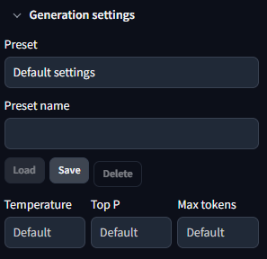

**Generation settings** では生成のばらつきや出力の長さを調整します。対応モデルでは **Temperature** と **Top P** にモデル・用途に応じた値が入ります。**Default** はその項目を LM Studio に任せる設定です。自分で調整した値は名前を付けて保存できます。

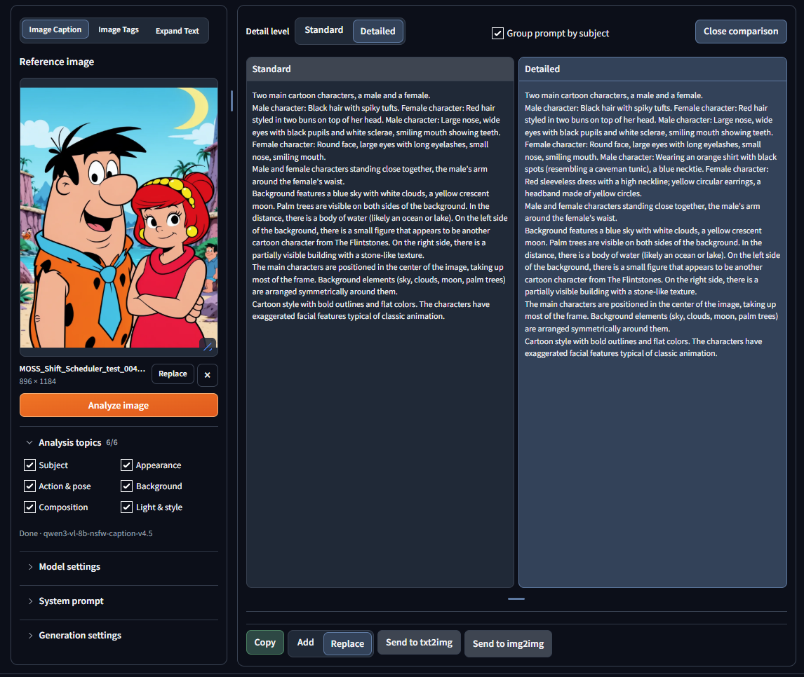

**Compare prompts** で、同じ生成結果の **Standard / Detailed** を読み比べられます。横並び表示の初期状態では左パネルと下端が揃い、長い列は中をスクロールできます。比較欄の下のつまみを動かすと2列の高さをまとめて変更でき、次回もその高さで開きます。

### 選んだプロンプトを使う

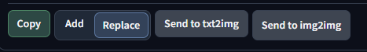

**Copy** は現在選んでいるプロンプトをコピーします。Forge に送るときは **Add**（Positive の末尾に追記）または **Replace**（Positive 全体を置換）を選んでから **Send to txt2img** または **Send to img2img** を押します。

## 操作

1. PNG・JPEG・WebP の静止画を選びます。ドロップや、画像欄にフォーカスしての貼り付けにも対応します。画像は64 MiB、6,400万画素までです。
2. **WD** または **PixAI** を選んで **解析** を押します。初回に必要なファイルがなければ **取得して解析** に切り替わります。
3. 採用タグを編集します。**候補**ではカテゴリと名前で絞り込み、使いたいタグを選べます。タグにマウスを重ねると検出スコアが分かります。
4. 出力形式と詳しさをボタンで選びます。**プロンプト比較** で、同じ解析結果から標準・詳細・最詳細を並べます。各欄の見出しを押すとコピー・送信する出力を切り替えられます。比較欄は同じブラウザーで前回の開閉状態に戻ります。
5. **コピー** または **txt2img／img2img に送る** を押します。**追記** は選んだタブの Positive の末尾に追加し、**置換** は Positive 全体を現在の出力で置き換えます。

初回は **WD・タグ・詳細・追記** が選ばれます。同じブラウザーで開いたときは、最後に選んだモード・出力形式・詳しさ・送信方法を復元します。旧版で **シンプル** を選んでいた場合は **標準** で開きます。

**キャラクターだけ解析** は、顔・表情・髪・体の特徴・衣装・身につけた小物に絞って出力します。タグ、説明文、プロンプト比較、コピー、送信で同じ範囲が使われます。同じ画像・モデル・デバイスで **解析** と切り替えると、検出済みのスコアを再利用します。それぞれのタグと説明文の手修正は、参照画像を差し替えるまで保持します。

画面の言語は右上の **EN / 日本語** で変えられます。タグと自動説明文は英語です。説明文は採用タグから組み立てるので、表示形式や詳しさの切替・比較に画像の再解析は必要ありません。説明文は段階ごとに編集できます。

**読みやすく整形** をオンにすると、タグを人物、服装、動作、情景、構図などの行に分けます。自動説明文も人物と情景で段落を分けます。プレビュー、比較、コピー、送信、一括保存で同じ整形を使い、切り替えに再解析は不要です。初期値はオフで、最後の選択を復元します。

**最詳細** は **詳細** より広いスコア範囲から一般タグを拾い、通常解析の説明文にも追加の描写を反映します。不要なタグは採用欄から外せます。

解析中にモデルを切り替えても、実行中の解析は開始時のモデルで完了します。進捗欄には実際に解析しているモデル名が出ます。プレビューは次の解析が完了した時点で更新されます。切り替え先のモデルは次に **解析** を押したときに使われます。

画像の解析、セリフの読み取り、話者推定、モデル取得の処理中は、タブの上端に細い進捗線が出ます。

参照画像の右下をドラッグすると、画像欄の幅と高さを調整できます。縦並びの画面では高さを調整します。画像欄とタグ欄の境界でも幅を変えられます。出力プレビューは下端で高さを調整します。各ハンドルにフォーカスして矢印キーでも調整でき、ダブルクリックまたは Escape で初期サイズに戻せます。

## LM Studio で画像解析・文章補完

1. **LM Studio** を選び、入力欄の上で **画像から説明文**、**画像からタグ**、**短文を補完** のいずれかを選びます。初回の用途は **画像から説明文**、詳しさは **標準** です。
2. **画像を解析** または **プロンプトを補完** のボタンより下にある設定欄の先頭に **モデル設定** があります。ここで LM Studio の接続先、モデル、解放方法を確認します。推奨は **Qwen3-VL 8B** です。この拡張では `qwen3-vl-8b-nsfw-caption-v4.5` で動作を確認しています。JoyCaption など他の対応モデルも選べます。画像の用途には画像対応モデルが表示されます。
3. 画像を入れて **画像を解析**、または短い文章を入力して **プロンプトを補完** を押します。短文補完は **出力言語** で **英語** または **自動** を選べます。初回は英語です。自動では入力文の言語または文中の言語指定に従います。画像内に表示する文字として指定した文は原文を保ちます。

**画像を解析** のすぐ下にある **解析項目** を開くと、被写体、外見・服装、動作・ポーズ、背景、構図、光・画風を選べます。初回は折りたたみ表示で、6項目すべてにチェックが入っています。開閉状態と、「画像から説明文」「画像からタグ」それぞれの選択をブラウザーに保存します。

「外見・服装」では、**標準** は被写体の主な形と「どの部分が何色か」を捉えます。人物なら髪や表情、服の種類・形・色、見えている重ね順も対象です。動物や物なら特徴のある部位や模様を、名前の分からない形や抽象画なら輪郭と色の分布をそのまま記述します。**詳細** では、元の画像を再現する手がかりになる差し色や質感、装飾、色の移り変わりを、見えている位置とともに加えるようモデルに指示します。

解析ボタンを押すと、選んだ項目をモデルに伝えます。解析後はチェックを切り替えるだけで、取得済みの項目をプレビュー、比較、コピー、送信に反映できます。前回の対象外だった項目を選ぶと **次の解析で反映** と表示され、もう一度 **画像を解析** を押すと読み取ります。

**標準・詳細** は1回の生成で取得し、ボタンや **プロンプト比較** から選べます。比較欄は、次に比較できる結果が出たときに前回の開閉状態で表示します。詳しさや整形を切り替えると、同じ結果から表示を更新します。編集した結果はコピーや txt2img／img2img への送信に使えます。

**読みやすく整形** がオンのときは、生成された人物・外見・動作・情景などを改行で分けます。オフにすると、項目間の改行を入れずにまとめます。初期値はオンで、同じブラウザーで前回の選択を復元します。切り替えはプレビュー、比較、コピー、送信に反映されます。自動出力から定型の品質タグと Negative 欄を除きます。

生成プロンプト欄と比較欄は、下端のつまみをドラッグすると高さを調整できます。比較欄は2列が一緒に伸びます。高さは欄ごとに同じブラウザーへ保存されます。つまみにフォーカスして上下の矢印キーでも調整でき、長い文章は End キーで表示範囲を広げられます。ダブルクリックまたは Escape で初期の高さに戻ります。

解析・補完ボタンの下にある **システムプロンプト** で、共通システムプロンプトを編集できます。「標準」は画像用と短文補完用の英文が用途に応じて切り替わります。短文補完用の英文は、元の題材や指定を保ち、背景・構図・光などに具体性を加えるように指示します。手入力・空欄・保存済みプリセットを使っている間は、その内容を保持します。**初期値に戻す** を押すと、現在の用途の標準文に戻ります。

**生成設定** のプリセットには用途と生成パラメーターを保存できます。システムプロンプトのプリセットと同じように、名前を選んで切り替え、**読み込む** で選択中のプリセットを保存時の状態に戻します。保存先は Forge データフォルダー内の `image_tagger/lm_studio.sqlite3` です。同じ Forge に接続するブラウザーで共有されます。

LM Studio へは共通プロンプトと選択した用途の処理指示を渡します。

## フォルダー一括

1. **参照画像** の下にある **フォルダー一括（Folder batch）** を開き、**画像フォルダーを選ぶ** を押します。保存先は初期状態では画像と同じ場所です。別の場所に出力するには **保存先を選ぶ** を押します。
2. 一括保存の **出力形式** を選びます。既定は **タグ** で、**タグ＋説明文** と **説明文** も選べます。**共通タグと保存設定** を開くと、先頭に追加するタグと除外するタグをカンマ区切りで入力できます。先頭タグは **タグ** と **タグ＋説明文** で使われます。共通タグ欄の入力はページを開いている間に有効です。
3. **3枚で試す** を押すと、保存対象から最大3枚の画像とテキストを確認できます。試し出力はプレビューに表示されます。内容を確かめたら **.txt を保存** を押します。必要に応じてブラウザーで保存先への書き込みを許可します。
4. 保存・スキップ・失敗の件数を確認します。失敗やファイル名の重複は **内訳を表示** で確認できます。更新の確認後に他のアプリなどで変更されたテキストも、上書きせず内訳に表示します。途中で **停止** した場合も、書き出したファイルは残ります。
5. **結果を見る** で、画像と対応する保存済みのテキストを並べて編集できます。ファイル名の一部やタグの完全一致で絞り込み、現在のファイルを **変更を保存** で更新できます。

選んだフォルダー直下の PNG、JPEG、WebP を1枚ずつ解析し、`sample.png` なら `sample.txt` を選択した保存先に UTF-8 で作成します。開始時のモデル、詳しさ、デバイス、閾値、自動ダウンロードと整形の設定が適用されます。保存先に同名の `.txt` があれば標準ではスキップします。内容を作り直す場合は、別の保存先を選ぶか、**既存の .txt を更新** を選んで対象件数を確認します。画像同士の保存名が重複した場合や、**説明文** のみの出力で説明文を作れなかった場合は、スキップの内訳で確認できます。

一括と試し出力の検出スコアは、Forge のデータディレクトリー内の `cache/image_tagger/analysis.sqlite3` に保存されます。同じ画像・モデルの版・デバイス設定なら、Forge の再起動後もスコアを再利用できます。閾値・詳しさ・整形・共通タグ・出力形式を変えるだけなら、保存済みのスコアから出力を組み立てます。CUDA のメモリ不足で CPU に切り替えた画像は、次回の処理で実行先をあらためて判定します。

フォルダーへの書き込みに対応した Edge や Chrome で、`http://127.0.0.1`／`http://localhost` の Forge または HTTPS を開いて使用します。 [フォルダーへのアクセス](https://developer.chrome.com/docs/capabilities/web-apis/file-system-access#opening_a_directory_and_enumerating_its_contents)

## 文字・セリフの読み取り（OCR1）

参照画像の下の **文字・セリフ** を開きます。**自動で読む** は吹き出し内と枠外の文字を検出し、元画像から切り抜いて日本語を読み取ります。**囲って読む** は、画像上の選択範囲だけを読み取ります。**手入力** で直接書き、必要に応じて **位置を囲む** で配置を指定できます。

番号を押すと画像上の枠が強調されます。同じ位置で同じ文字を読み取った候補は一つにまとめます。本文や改行、リストの順番を確認し、使う候補に **採用** を付けます。本文を変更した場合は、確認してから再度採用します。採用した候補は **タグ＋説明文** と **説明文** に加わり、コピーや txt2img／img2img への送信で使えます。

初回は使用するファイルを Forge のモデルディレクトリー内の `image_tagger/ocr` に自動取得し、サイズと SHA-256 を照合します。自動読み取りでは検出器（約11 MB）と Manga OCR（約444 MB）、範囲読み取りでは Manga OCR を使います。手入力はその場で使えます。実行先は **詳細設定 → 解析デバイス** に従い、検出器は CPU で動きます。認識の Auto は CUDA の空きが少ないときや生成に使われているときに CPU を使います。 [Manga OCR](https://github.com/kha-white/manga-ocr) · [吹き出し検出器](https://huggingface.co/ogkalu/comic-text-and-bubble-detector)

## 話者と MOSS レイアウト（OCR2）

1. セリフを読み取って **話者を推定** を押します。各行の **話者** で候補を確定できます。人物が重なって見える場合は、画像に表示される番号で選べます。
2. **画像で選ぶ** で話者を切り替え、**人物を囲む** で新しい人物を登録できます。**人物枠を直す** と **位置を囲む** で人物と吹き出しの枠を個別に調整します。これらの修正と並べ替えは、採用済みの本文をそのまま使います。
3. **MOSS JSON** で生成サイズを確認し、採用済みのセリフをコピーまたは保存します。未確定の話者は、セリフと枠だけを出力します。位置が未設定の行は番号で表示されます。表示した生成サイズで、JSON を MOSS-Image-Base の Positive に貼り付けます。 [MOSS のレイアウトガイド](https://github.com/OpenMOSS/MOSS-Image/blob/main/USERGUIDE.md#layout-prompts-experimental)

**話者を推定** の初回操作で MAGI v2 の設定とモデル（約2.06 GB）を `image_tagger/ocr/magi-v2` に取得して照合します。モデルカードの利用条件は個人・研究・非営利などの用途を対象としています。人物の手動指定と JSON 書き出しは、モデルを準備する前から使えます。 [MAGI v2 のモデルカード](https://huggingface.co/ragavsachdeva/magiv2)

## モデルの保持

**LM Studio → モデル設定 → モデルの解放** の初期値は「Forgeの画像生成前に解放」です。ローカルのLM StudioでImage Taggerが使用したインスタンスを、次のtxt2img／img2imgのモデル読み込み前に解放し、ロード一覧で確認します。「解析・補完のたびに解放」「LM Studioの設定に従う」も選べます。「選択モデルを今すぐ解放」は選んだモデルのロード済みインスタンスを対象にします。通信エラー時は解放済みと表示しません。

**Models／モデル** の中で、**解析後に解放**（初期値）、**時間で解放**、**保持する** を選べます。時間で解放する場合は最後の解析から数える秒数を指定します。**今すぐ解放** は手動でロード済みセッションを解放します。推論中に押した場合はその推論が終わった時点で解放します。ダウンロード済みファイルと表示済み出力は引き続き使えます。

**Auto** は CUDA が利用でき、モデルの読み込みに必要な空き VRAM があるときに CUDA を使います。デバイス欄に実際に使った実行先を表示します。空きが少ない場合や回復可能な CUDA エラーでは CPU に切り替えます。CUDA 蓄積メモリを抑える設定と、CPU のスレッド数自動選択を使います。保持する設定でも、Forge の txt2img・img2img の生成前にはCPU・GPUの保持モデルを、CUDAメモリ不足時にはGPU上のタガーを解放します。Forge の再起動や Reload UI では保持設定が初期値に戻ります。

## モデルの取得先

| モデル | ファイル | 配布元 |
|---|---|---|
| PixAI Tagger v1.0 FP16 | `model_fp16.onnx`、`selected_tags.csv`、`preprocess.json` | [Mexes の ONNX 変換版](https://huggingface.co/Mexes/pixai-tagger-v1.0-onnx-fp32-fp16-int8) |
| WD EVA02 Large v3 | `model.onnx`、`selected_tags.csv` | [SmilingWolf](https://huggingface.co/SmilingWolf/wd-eva02-large-tagger-v3) |

自動取得の保存先は Forge のモデルディレクトリ内の `image_tagger` です。下に `pixai_v1_fp16` と `wd_eva02_large_v3` のフォルダーができます。**自動ダウンロード**をオフにすると、モデル行の **ダウンロード** から必要なものだけを取得できます。

**Models／モデル** を開くと、モデルごとのダウンロード先を確認できます。ローカルの Forge では **フォルダーを開く** からファイルマネージャーを開けます。**削除** は確認後、そのモデルのダウンロード先にあるモデルファイルと付属メタデータを削除します。他のモデルや共有ファイルは対象外です。解析または対象モデルのダウンロードが終わってから削除できます。自動ダウンロードが有効なら、削除したモデルは次に必要になったときに再取得します。

Anima の検証済みファイルを共用するには、Forge の **Settings → Image Tagger** で、その二つのフォルダーを含むディレクトリを指定します。モデル欄には共有の読み込み先も表示されます。共有フォルダー内のモデルを読み込み、不足ファイルの取得には拡張の保存先を使います。配布リビジョンと SHA-256 は拡張のモデル定義にあります。画像解析と説明文の生成は Forge の実行環境内で行います。

## 初期実装時の実機確認

2026-11-26 に、隔離データで起動した Windows の Forge Neo `6d5aa3bc`（Gradio 4.40.0）で確認しました。使用 GPU は RTX 5060 Ti、検証専用 ONNX Runtime は 1.31.1 です。

| 確認項目 | 結果 |
|---|---|
| モデル自動取得 | PixAI の3ファイルと WD の2ファイルを取得。全5ファイルのサイズ・SHA-256 が一致。 |
| PixAI 単独 | CPU で解析完了。サンプルの標準／詳細は 19／36 タグ。 |
| CUDA 解析 | PixAI と WD の CUDA 推論を確認。 |
| 再解析なしの出力 | 詳しさの切替・比較の開閉・形式切替による解析要求の増加ゼロ。 |
| コピーと送信 | Edge の標準 Clipboard API から選択中の出力を読み戻して一致。ネイティブ txt2img／img2img の Positive に追記し、既存文・Negative を保持。再送時の重複回避と、img2img の Inpaint 選択の保持を確認。 |

## ライセンスと参照元

前処理とモデル照合には、同じ配布ファイルを扱う [Anima Character Sheet Designer](https://github.com/ukr8b3g-cmyk/Anima-Character-Sheet-Designer) の定義と MIT ライセンスの実装を参照しています。モデルのライセンスは各配布ページを参照してください。

コードのライセンスと、スクリーンショット・外部モデルの扱いは [LICENSE](LICENSE) と [NOTICE](NOTICE.md) に記載しています。
